# TP Diseño Web — Café y Arte Latte

Trabajo práctico de Programación Web. Tema elegido: sitio web para mostrar datos del barismo, el arte latte y el café.

> El tema no se puede cambiar en el transcurso del año. Cualquier modificación debe reflejarse en toda la documentación.

## Barismo & Café — Maqueta web (TP N° 3)

Sitio estático de **Barismo & Café**, una cafetería de especialidad dedicada al barismo, al arte
latte y a la formación de baristas. Las 10 vistas se maquetaron en HTML5 + Bootstrap 5 a partir
de los wireframes de Figma.

- **Diseño en Figma:** [Site Map and Wireframe](https://www.figma.com/make/uKNA9mewDLy8gzO9RdJhTZ/Site-Map-and-Wireframe?t=ofV6AHS95d6uyXOT-1&preview-route=%2F%23galer%25C3%ADa)
- **Sitio publicado (GitHub Pages):** https://julieta-andrea-cardozo.github.io/programacion_WEB/
- **Auditoría de Lighthouse y Prettier:** [docs/auditoria-lighthouse.md](docs/auditoria-lighthouse.md)

### Tecnologías

| Tecnología                      | Uso                                                                    |
| ------------------------------- | ---------------------------------------------------------------------- |
| HTML5 semántico                 | Estructura de las 10 vistas                                            |
| CSS3 (variables, grid, flexbox) | Estilos propios en `css/styles.css`                                    |
| Bootstrap 5.3.3 (CDN)           | Grilla responsive, navbar colapsable, pestañas, collapse y formularios |
| JavaScript                      | Carrito con `localStorage` y validación del formulario (`js/main.js`)  |
| Google Fonts                    | Playfair Display, Inter y DM Mono                                      |
| Prettier 3                      | Formateo del código                                                    |
| Lighthouse                      | Auditoría de accesibilidad, rendimiento, buenas prácticas y SEO        |
| Git + GitHub + GitHub Pages     | Control de versiones y despliegue                                      |

### Vistas

| #   | Vista     | Archivo          | Contenido                                                 |
| --- | --------- | ---------------- | --------------------------------------------------------- |
| 1   | Inicio    | `index.html`     | Hero, sobre nosotros, accesos destacados y testimonios    |
| 2   | Menú      | `menu.html`      | Cafés de especialidad y tabla de acompañamientos          |
| 3   | Galería   | `galeria.html`   | Galería de diseños de arte latte                          |
| 4   | Equipo    | `equipo.html`    | Perfiles de los baristas                                  |
| 5   | Talleres  | `talleres.html`  | Talleres de barismo con nivel, fecha y precio             |
| 6   | Blog      | `blog.html`      | Notas destacadas desplegables                             |
| 7   | Tienda    | `tienda.html`    | Café en grano e insumos para cafetera con carrito         |
| 8   | Técnicas  | `tecnicas.html`  | Pestañas con el paso a paso de corazón, tulipán y rosetta |
| 9   | Ubicación | `ubicacion.html` | Mapa embebido, horarios y datos de contacto               |
| 10  | Contacto  | `contacto.html`  | Formulario con validación y casillas de contacto          |

### Estructura del proyecto

```
programacion_WEB/
├── index.html … contacto.html   # 10 vistas
├── css/styles.css               # estilos personalizados
├── js/main.js                   # interacciones
├── img/                         # imágenes y favicon
├── docs/                        # auditoría Lighthouse y capturas
├── .prettierrc / .prettierignore
└── package.json                 # scripts de Prettier
```

### Ejecución local

```bash
git clone https://github.com/Julieta-Andrea-Cardozo/programacion_WEB.git
cd programacion_WEB
npm install            # instala Prettier (opcional)
python3 -m http.server 8080
# abrir http://localhost:8080
```

También se puede abrir `index.html` directamente en el navegador o usar _Live Server_ de VS Code.

### Flujo de trabajo con Git

1. `git init` y estructura base `css/`, `js/`, `img/`.
2. Rama de trabajo `feature/maquetacion`.
3. Maquetación de las 10 vistas con Bootstrap y estilos propios.
4. Formateo con Prettier y auditoría de Lighthouse (ver `docs/auditoria-lighthouse.md`).
5. `git push origin feature/maquetacion` y Pull Request hacia `main`.
6. Merge del Pull Request.
7. Despliegue en GitHub Pages.

### Capturas

| Inicio                                  | Menú                                    |
| --------------------------------------- | --------------------------------------- |
| 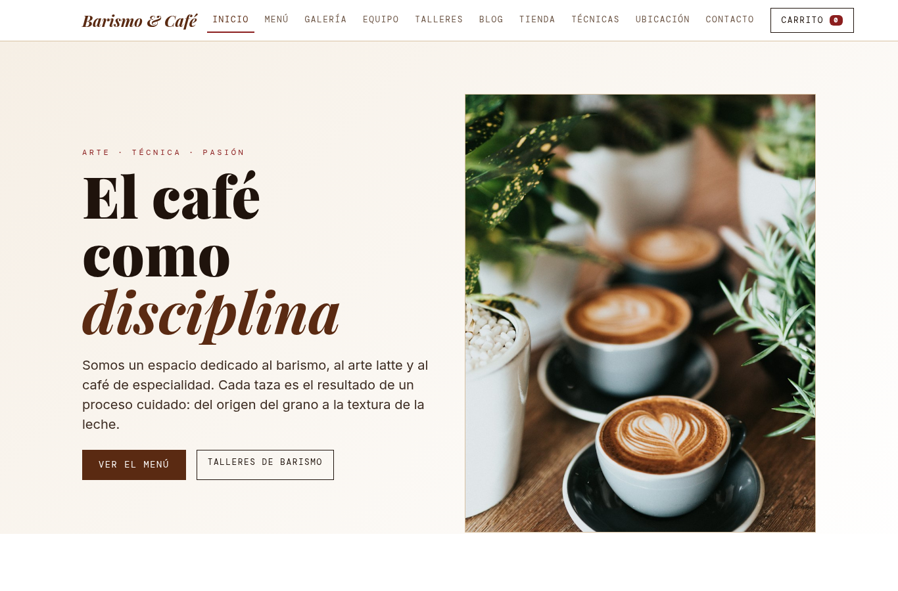      | 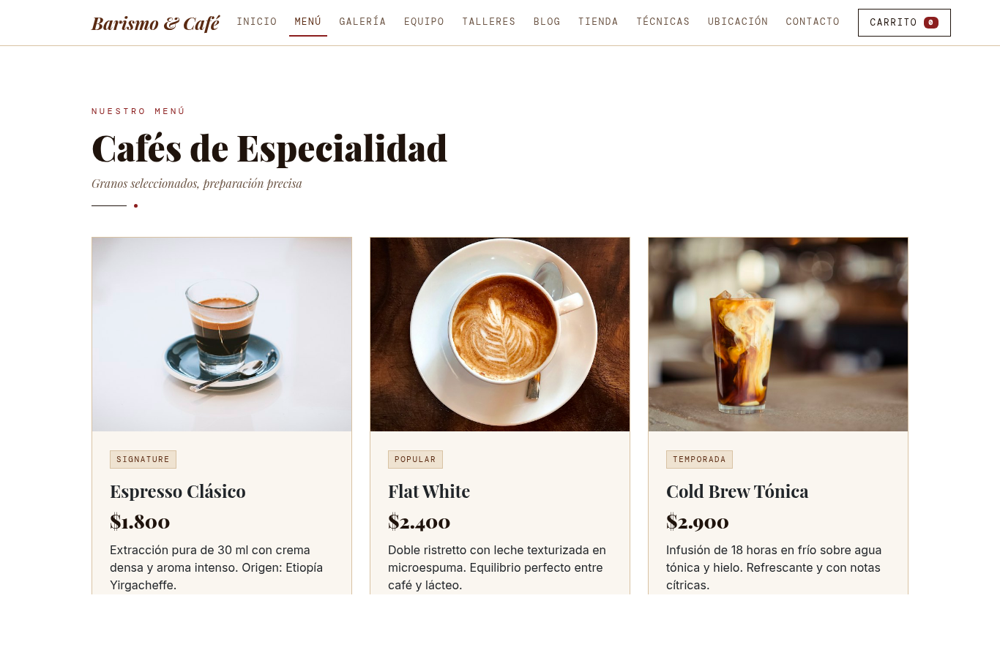         |
| **Galería**                             | **Tienda**                              |
| 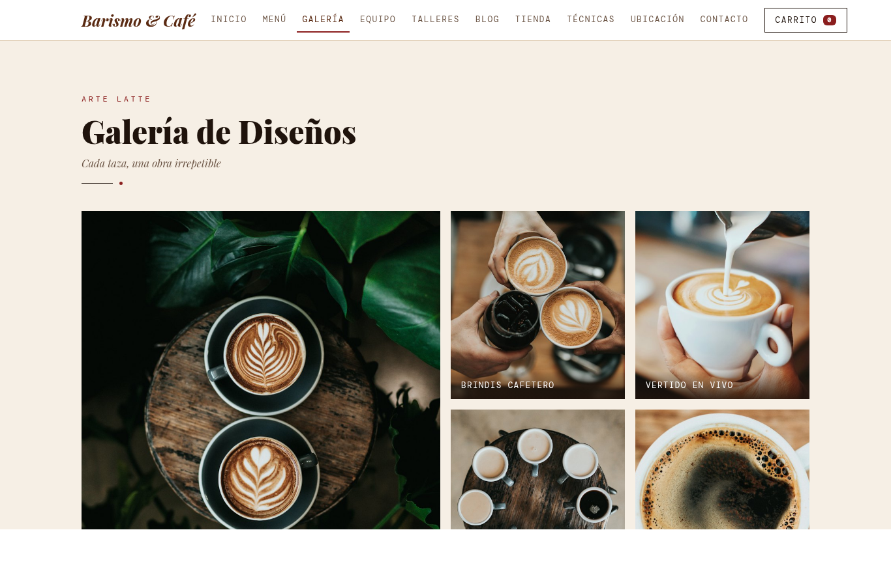   | 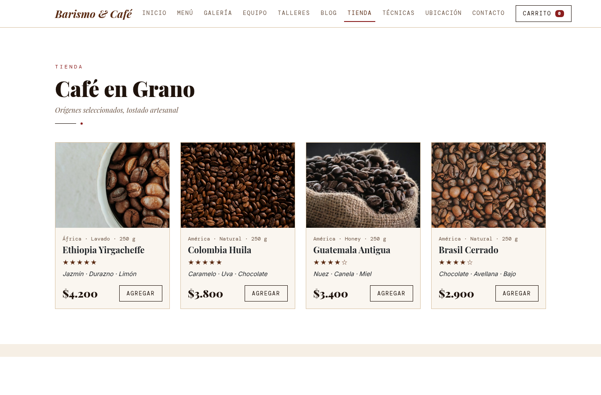     |
| **Técnicas**                            | **Contacto**                            |
| 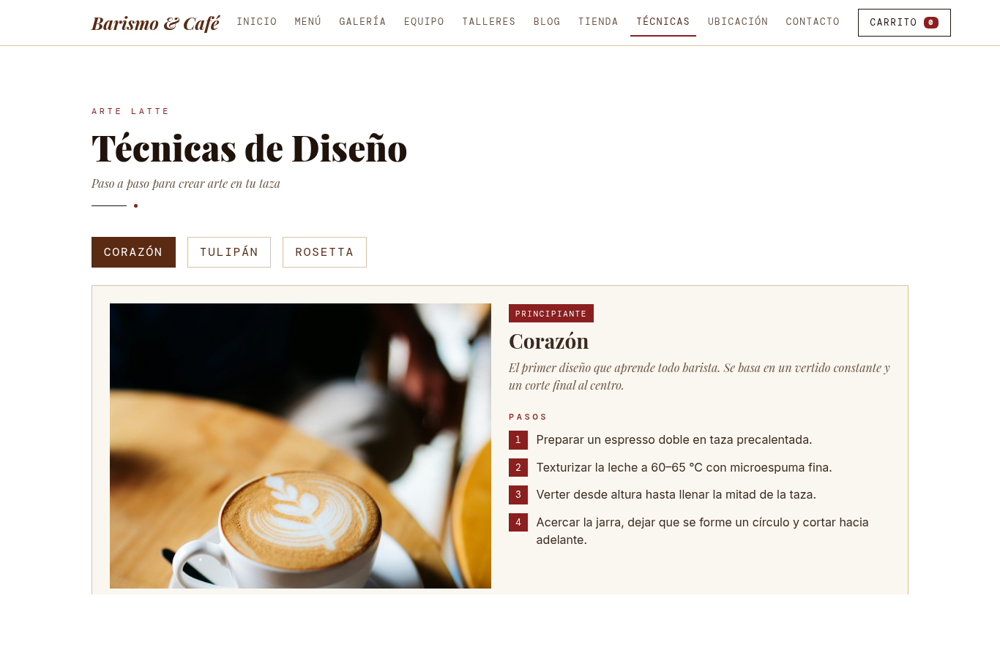 | 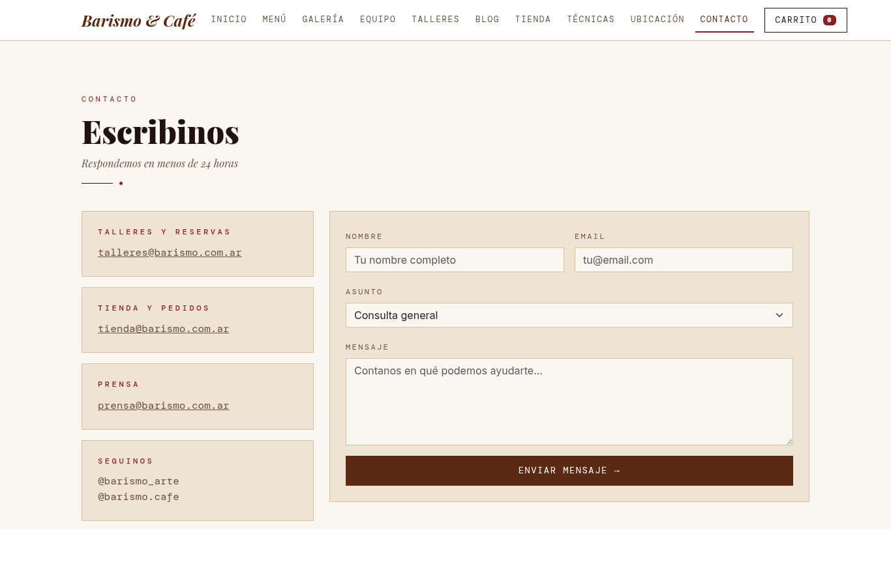 |

## Migración a PHP, modularización (SSI) y renderizado server-side (TP N° 4)

En la rama `feature/migracion-php-ssi` las 10 vistas pasaron de `.html` a `.php`. El código
repetido (cabecera, navegación y pie) se extrajo a `includes/`, y el servidor arma cada página
antes de enviarla al navegador.

### Qué cambió

| Requisito               | Implementación                                                                                                                                                                   |
| ----------------------- | -------------------------------------------------------------------------------------------------------------------------------------------------------------------------------- |
| Vistas en PHP           | `index.php`, `menu.php`, `galeria.php`, `equipo.php`, `talleres.php`, `blog.php`, `tienda.php`, `tecnicas.php`, `ubicacion.php`, `contacto.php`                                  |
| Modularización (SSI)    | `includes/header.php`, `includes/nav.php` e `includes/footer.php` incluidos con `require_once`                                                                                   |
| Título dinámico         | Cada vista define `$titulo_pagina` (y `$descripcion_pagina`) antes de incluir el header, que imprime `<title><?= e($titulo_pagina) ?> \| <?= e(APP_NAME) ?></title>`             |
| Navegación activa       | `nav.php` recorre un arreglo de páginas y compara con `basename($_SERVER['SCRIPT_NAME'], '.php')` para agregar la clase `active` y `aria-current="page"`                         |
| Variables de entorno    | `config/config.php` lee `.env` y define `APP_NAME`, `APP_EMAIL`, `APP_PHONE`, `APP_ADDRESS` y `APP_ENV`. `.env` está en `.gitignore`; en el repo solo se versiona `.env.example` |
| Renderizado server-side | El menú y la tienda se generan con `foreach` sobre el catálogo `data/catalogo.php`. El año del footer sale de `date('Y')`                                                        |
| Formulario              | `contacto.php` valida el envío `POST` en el servidor, conserva los datos cargados, muestra los errores y escapa la salida con `htmlspecialchars`                                 |
| Seguridad               | `.htaccess` bloquea el acceso a `.env`, `.git`, `includes/`, `config/` y `data/`                                                                                                 |

Ejemplo de vista:

```php
<?php
$titulo_pagina = 'Menú';
$descripcion_pagina = 'Menú de cafés de especialidad de Barismo & Café.';

require_once __DIR__ . '/includes/header.php';
require_once __DIR__ . '/includes/nav.php';
require_once __DIR__ . '/data/catalogo.php';
?>
<main id="contenido">
  <?php foreach ($bebidas as $bebida) : ?> ... <?php endforeach; ?>
</main>
<?php require_once __DIR__ . '/includes/footer.php'; ?>
```

### Estructura (versión PHP)

```
programacion_WEB/
├── index.php … contacto.php   # 10 vistas PHP
├── includes/
│   ├── header.php             # <head> con título dinámico
│   ├── nav.php                # navegación con página activa
│   ├── footer.php             # pie con datos del .env
│   └── producto.php           # tarjeta de producto reutilizable
├── config/config.php          # carga de .env y constantes
├── data/catalogo.php          # bebidas, granos e insumos
├── css/ js/ img/ docs/
├── .env.example               # plantilla de configuración
└── .htaccess                  # reglas de Apache
```

### Instalación y ejecución local

1. Requisitos: PHP 8.0 o superior. Sirve XAMPP, Laragon o el servidor integrado de PHP.
2. Clonar el repositorio y crear el archivo de entorno:

   ```bash
   git clone https://github.com/Julieta-Andrea-Cardozo/programacion_WEB.git
   cd programacion_WEB
   cp .env.example .env      # en Windows: copy .env.example .env
   ```

3. Levantar el sitio con una de estas opciones:
   - **Servidor integrado de PHP:** `php -S localhost:8000` y abrir http://localhost:8000
   - **XAMPP:** copiar la carpeta en `C:\xampp\htdocs\programacion_WEB`, iniciar Apache y abrir
     http://localhost/programacion_WEB/
   - **Laragon:** copiar la carpeta en `C:\laragon\www\programacion_WEB`, iniciar todo y abrir
     http://programacion_WEB.test/ o http://localhost/programacion_WEB/

Variables disponibles en `.env`:

| Variable      | Ejemplo                       | Uso                                                                  |
| ------------- | ----------------------------- | -------------------------------------------------------------------- |
| `APP_NAME`    | `Barismo & Café`              | Marca, título y footer                                               |
| `APP_EMAIL`   | `hola@barismo.com.ar`         | Email de soporte (contacto y footer)                                 |
| `APP_PHONE`   | `+54 11 4832-1650`            | Teléfono del footer                                                  |
| `APP_ADDRESS` | `Thames 1650, Palermo · CABA` | Dirección del footer                                                 |
| `APP_ENV`     | `local`                       | Con `local` se muestran los errores de PHP y el entorno en el footer |

### Evidencias de funcionamiento

Probado con PHP 8.1 en Apache (`http://localhost/programacion_WEB/`) y con `php -S localhost:8000`.
Lighthouse en escritorio, sobre las 10 vistas PHP: **100** en Rendimiento, Accesibilidad,
Buenas prácticas y SEO.

| Servidor y títulos dinámicos                                       | Navegación activa (Menú)                                    |
| ------------------------------------------------------------------ | ----------------------------------------------------------- |
| 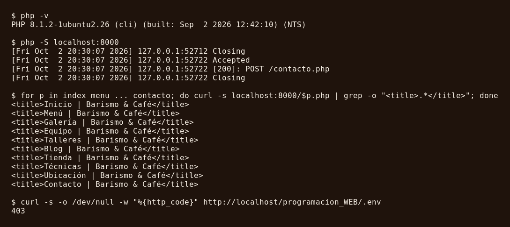 | 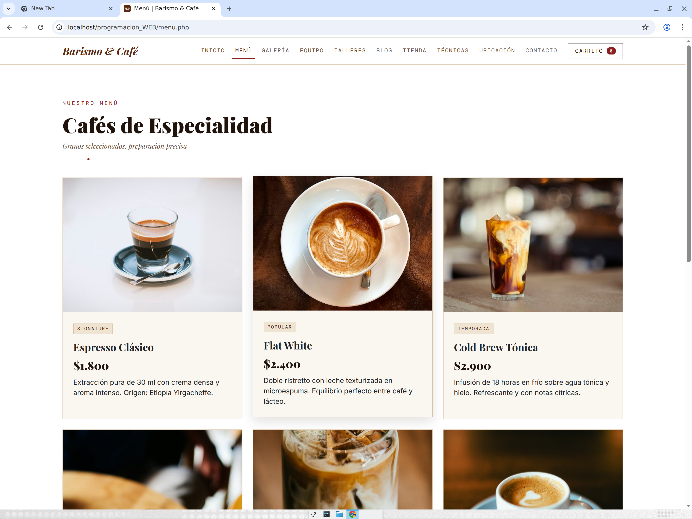               |
| **Tienda renderizada con PHP**                                     | **Formulario procesado en el servidor**                     |
| 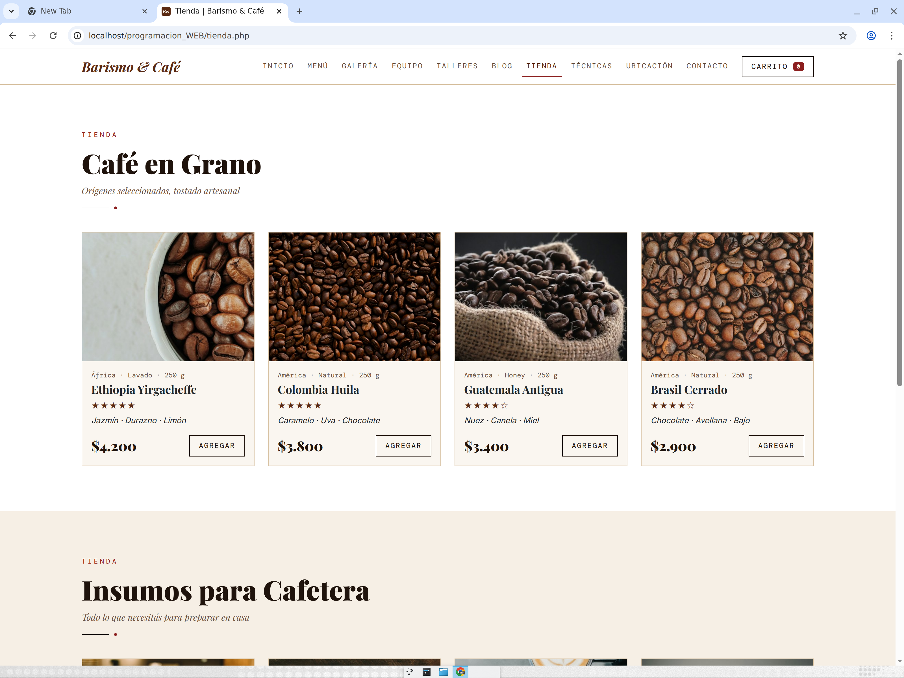                  | 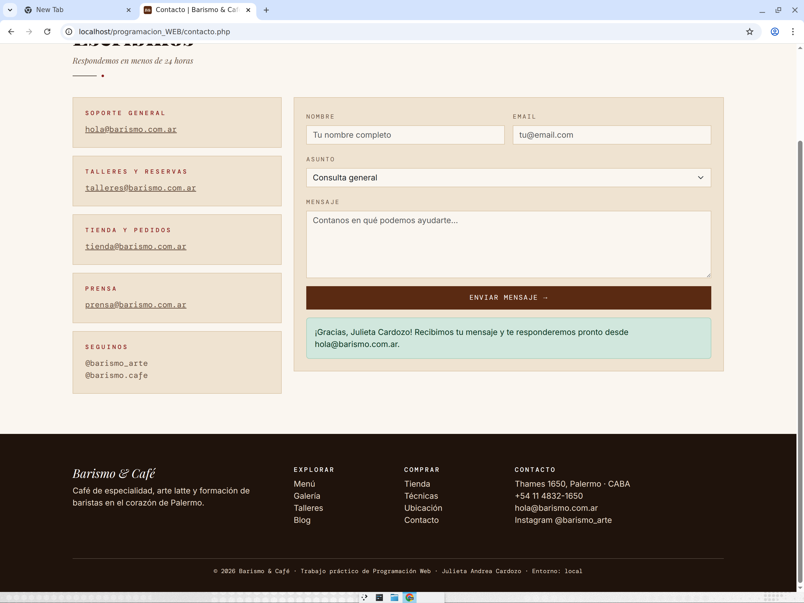 |
| **HTML generado por el servidor**                                  | **`.env` bloqueado (403)**                                  |
| 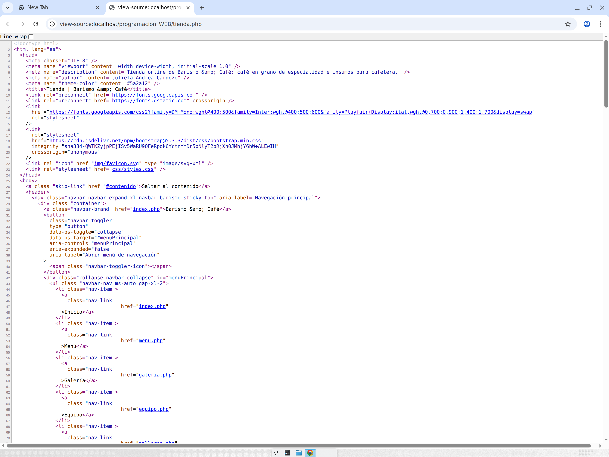       | 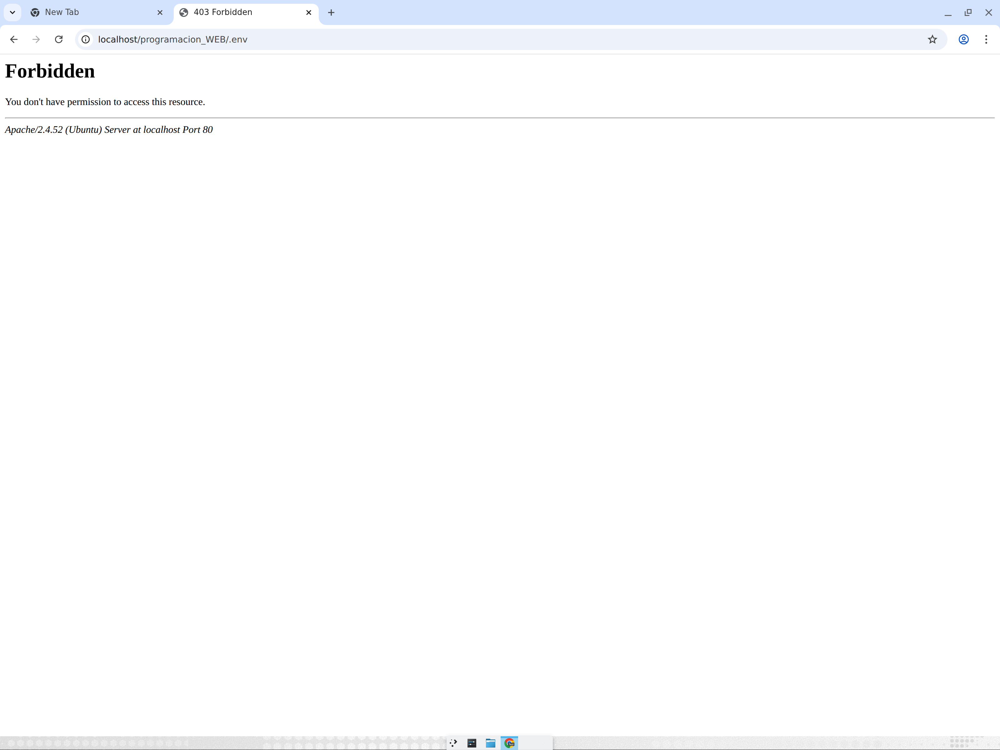      |

## Procesamiento de formularios con POST y GET (Clase 5)

Todo el desarrollo de esta entrega está en la carpeta [`clase5/`](clase5/), que contiene el sitio
completo en PHP. Se incorporaron dos interacciones de formulario que capturan y procesan datos en
el servidor, con sanitización estricta para prevenir XSS (OWASP Top 10).

### Formulario POST — `contacto.php`

Formulario de contacto (nombre, email, asunto y mensaje) que se envía por `POST` a la misma vista:

- **Sanitización:** cada campo se lee con `filter_input(INPUT_POST, ...)` y `trim()`, y toda la
  salida se escapa con `htmlspecialchars()` (función `e()` de `config/config.php`), por lo que un
  envío como `<script>alert(1)</script>` se muestra como texto y nunca se ejecuta.
- **Validación en el servidor:** nombre con mínimo 3 letras, email con
  `filter_var(..., FILTER_VALIDATE_EMAIL)`, asunto contra una lista blanca y mensaje con mínimo
  10 caracteres.
- **Retroalimentación:** los errores se muestran debajo de cada campo y en un aviso general; si el
  envío es válido aparece un mensaje de éxito con el nombre recibido.
- **Persistencia:** ante errores, los campos conservan lo que el usuario ya había cargado.

### Formulario GET — buscador en `tienda.php`

Buscador de productos (`?q=`) con filtro por categoría (`?tipo=`), que viaja por `GET` en la URL y
permite compartir el enlace de la búsqueda:

- **Sanitización:** `q` y `tipo` se leen con `filter_input(INPUT_GET, ...)` y `trim()`; el término
  se muestra escapado en el input y en el mensaje de resultado, por lo que no es posible inyectar
  scripts (ver captura de XSS).
- **Validación en el servidor:** `q` no puede llegar vacío ni superar los 60 caracteres; `tipo` se
  valida contra una lista blanca (`todo`, `granos`, `insumos`).
- **Retroalimentación:** informa cuántos productos se encontraron para el término, o un aviso cuando
  no hay coincidencias.
- **Persistencia:** el término buscado y la categoría elegida quedan cargados en el formulario.

### Capturas

| Búsqueda con resultados (GET)                                    | Sin resultados                                                            |
| ---------------------------------------------------------------- | ------------------------------------------------------------------------- |
| 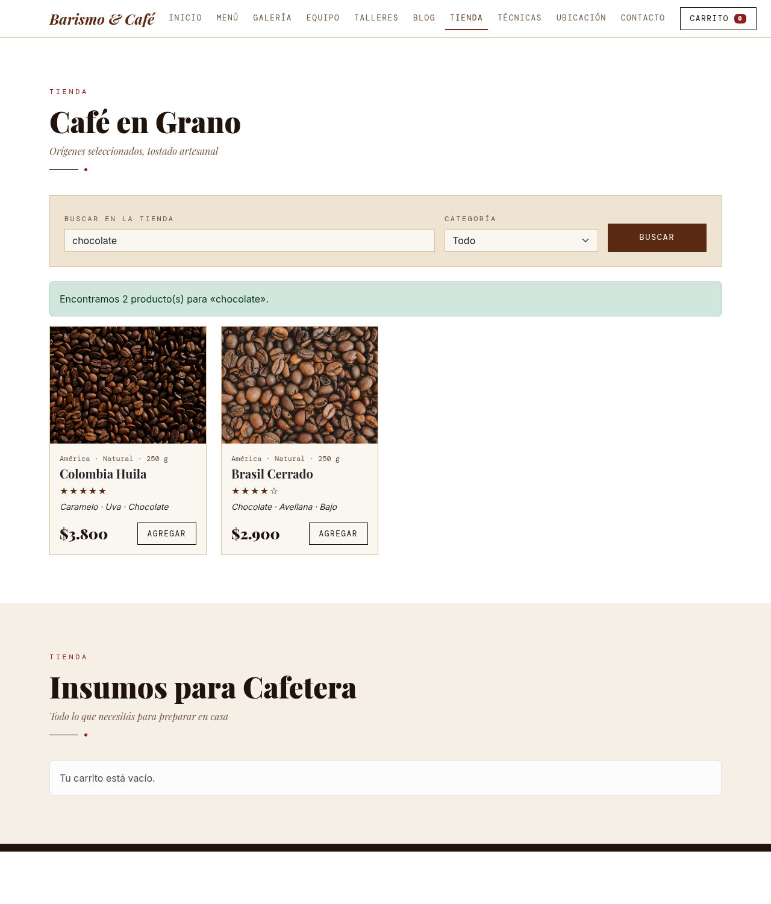                   | 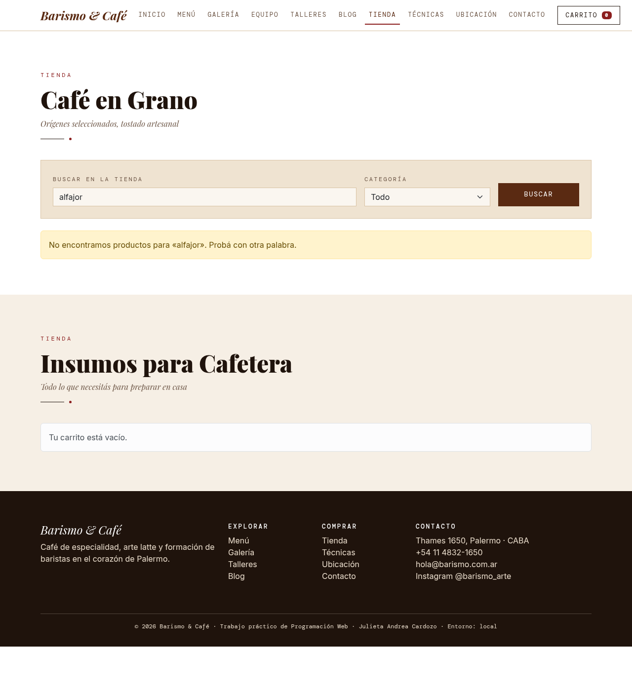       |
| **XSS sanitizado: el script se muestra como texto**              | **Errores de validación con datos conservados (POST)**                    |
| 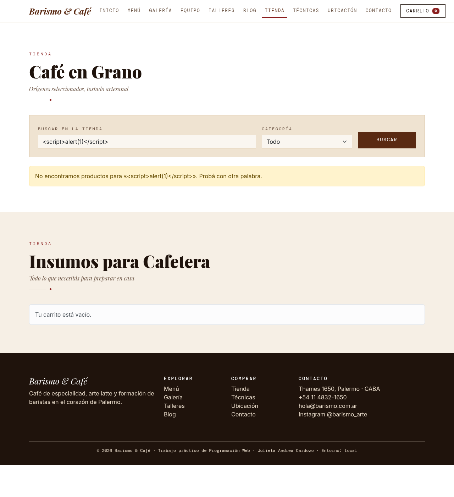         | 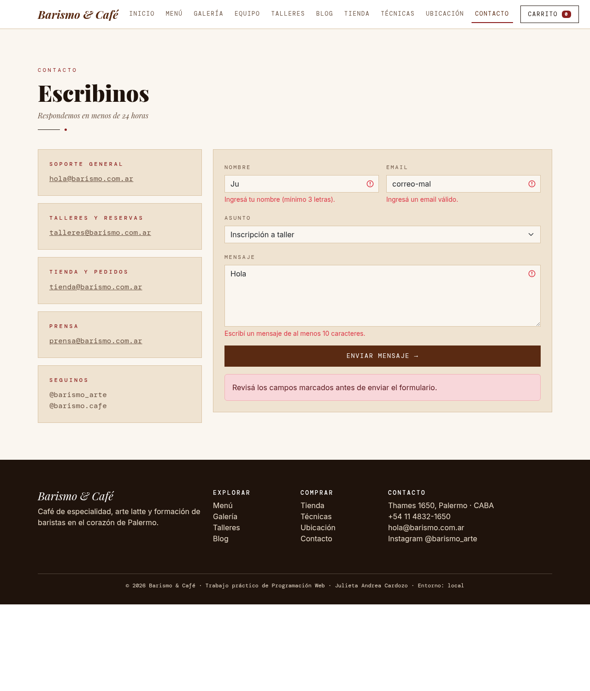                     |
| **Envío exitoso (POST)**                                         |                                                                           |
| 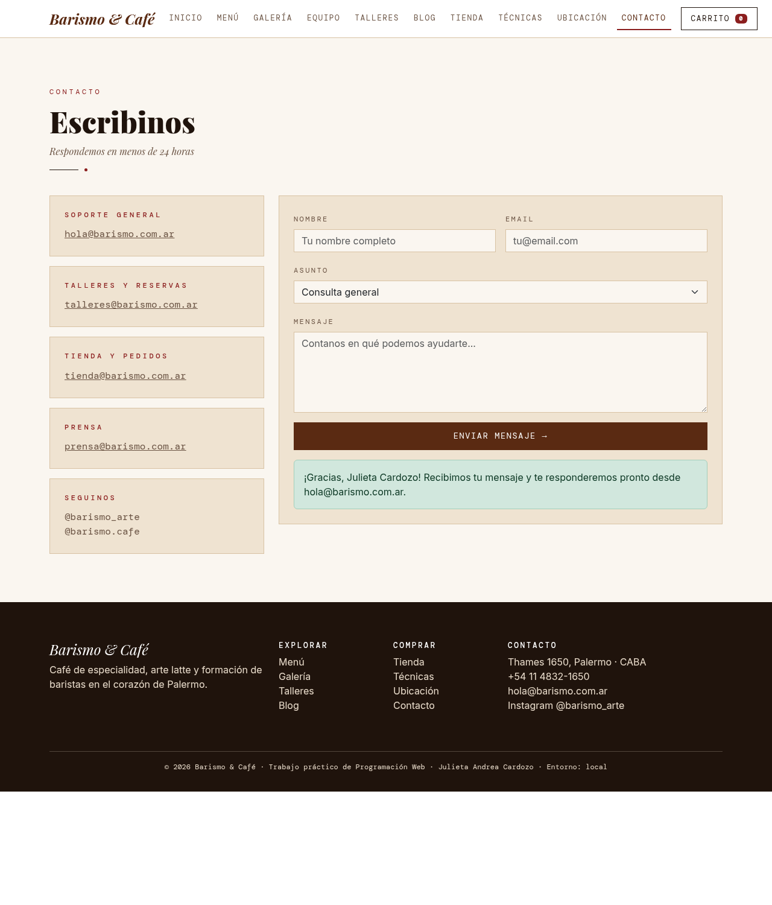                   |                                                                           |

### Ejecución local

```bash
cd clase5
cp .env.example .env   # en Windows: copy .env.example .env
php -S localhost:8000  # abrir http://localhost:8000
```

## Persistencia PHP–MySQL: CRUD de productos (Clase 7)

Todo el desarrollo de esta entrega está en la carpeta [`clase7/`](clase7/), que contiene el sitio
completo en PHP más el módulo de administración conectado a MySQL. Se implementó un CRUD sobre la
tabla `productos` (granos e insumos de la tienda), integrado al layout del sitio y accesible desde el
enlace **Administrar** del footer.

### Componentes

| Componente              | Archivo                                     | Qué hace                                                                                    |
| ----------------------- | ------------------------------------------- | ------------------------------------------------------------------------------------------- |
| Conexión segura         | `config/conexion.php`                       | Instancia PDO con `try-catch` (`PDOException`), credenciales desde `.env`                     |
| Listado (Read)          | `admin/index.php`                           | Tabla con todos los productos, consulta preparada `SELECT`, avisos de alta/baja/modificación |
| Alta (Create)           | `admin/crear.php`                           | Formulario validado en el servidor + `INSERT` preparado; redirige con `?status=created`      |
| Edición (Update)        | `admin/editar.php`                          | Carga el registro con `SELECT` preparado por `id` y guarda con `UPDATE` preparado            |
| Baja (Delete)           | `admin/eliminar.php`                        | Solo acepta `POST` con `id` entero validado; `DELETE` preparado; los enlaces GET no borran   |
| Formulario compartido   | `admin/formulario.php` + `admin/funciones.php` | Campos, validación y sanitización reutilizados por crear y editar                          |
| Esquema y datos iniciales | `sql/barismo.sql`                         | `CREATE DATABASE` + `CREATE TABLE productos` + los 8 productos del catálogo                  |

### Seguridad aplicada

- **Consultas preparadas obligatorias:** todas las operaciones (SELECT, INSERT, UPDATE, DELETE)
  usan `$pdo->prepare()` con marcadores `:parametro`; ningún dato del usuario se concatena en el SQL.
- **Sanitización XSS:** toda variable impresa en las vistas sale por `htmlspecialchars()` (`e()`).
- **Validación en el servidor:** `filter_input`/`filter_var` para enteros, listas blancas para
  categoría y estrellas, largos máximos y formato de nombre de archivo para la imagen.
- **Persistencia de campos:** ante errores de validación el formulario conserva lo cargado.

### Instalación de la base de datos (XAMPP / Laragon)

1. Importar `clase7/sql/barismo.sql` desde phpMyAdmin, o por consola:
   `mysql -u root < sql/barismo.sql`
2. Configurar `.env` (los valores por defecto ya son los de XAMPP):

   ```
   DB_HOST=localhost
   DB_NAME=barismo
   DB_USER=root
   DB_PASS=
   ```

3. Abrir `admin/index.php` dentro del sitio (o el enlace **Administrar** del footer).

### Capturas

| Listado con aviso de alta                                        | Formulario de nuevo producto                                  |
| ---------------------------------------------------------------- | ------------------------------------------------------------- |
| 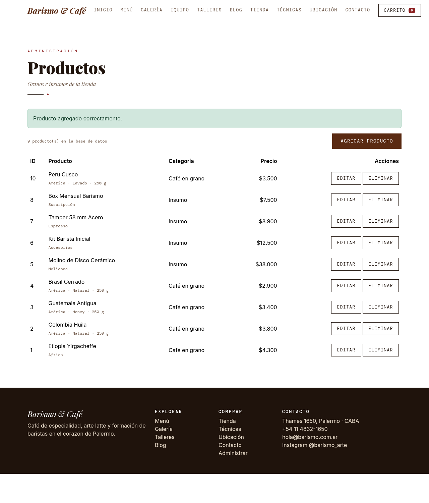               | 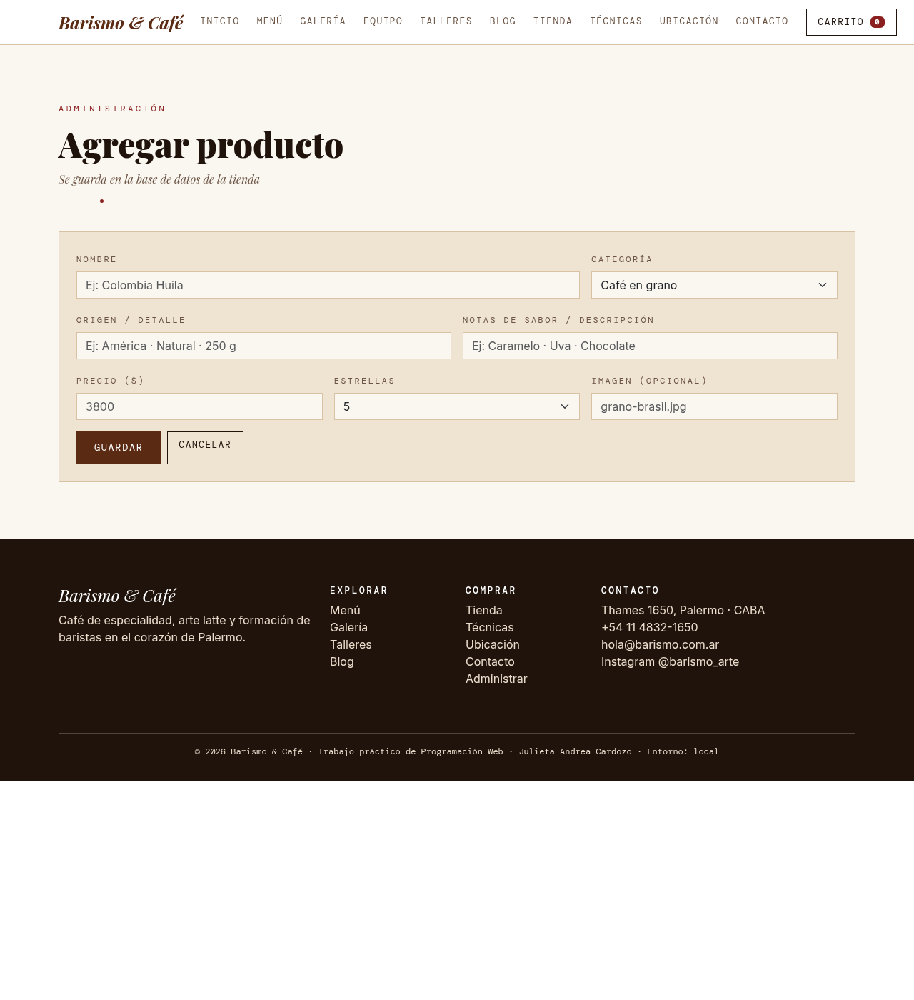                |
| **Edición con datos cargados**                                   | **Errores de validación en el servidor**                      |
| 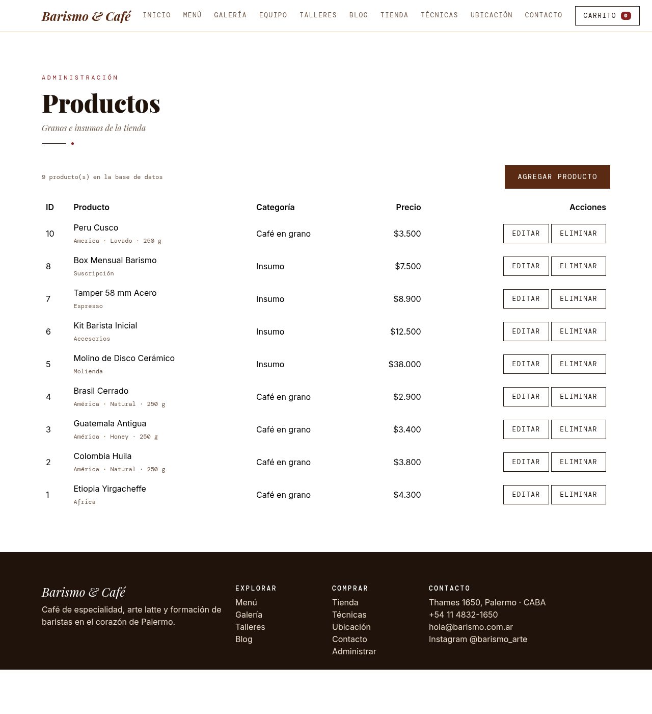                 | 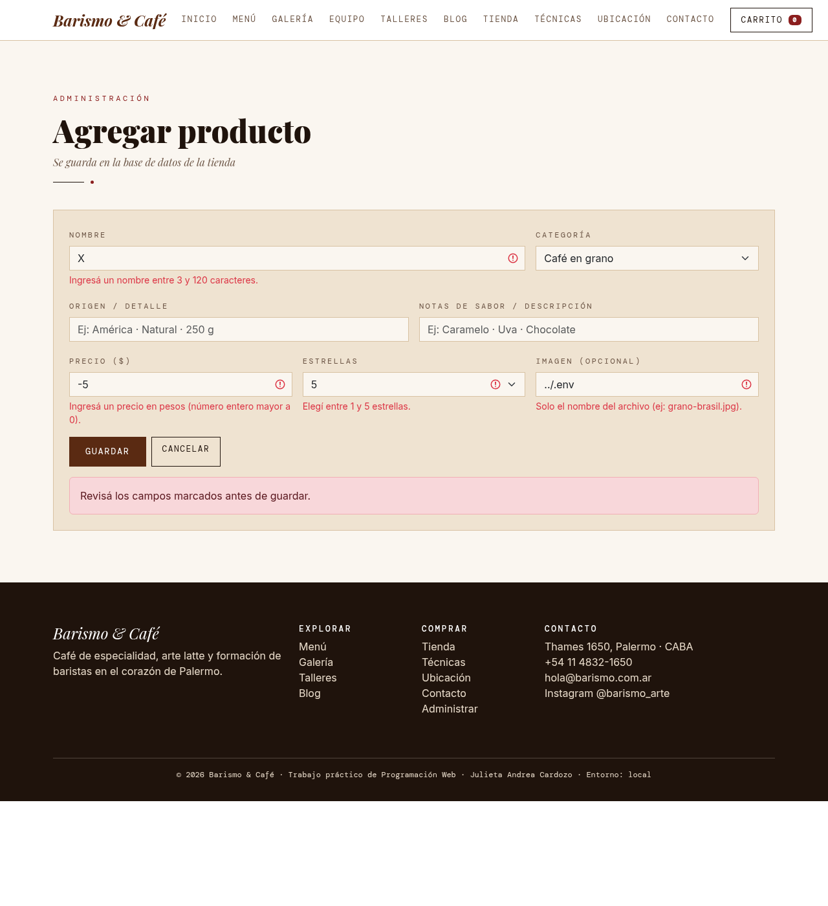            |

---

# Documentación de diseño (TP anteriores)

## 1. Intereses personales

Me interesa en particular todo lo relacionado con el café de especialidad: la preparación del espresso, la textura de la leche y el arte latte. También me gusta el diseño gráfico aplicado a lo cotidiano (menús, cartelería, identidad visual de un local) y estoy en contacto permanente con la cultura de internet y las redes sociales.

## 2. Tema elegido

**Tema:** sitio web para mostrar datos del barismo, el arte latte y el café.

Elegí este tema porque combino conocimiento de gastronomía (experiencia como barista) con lo que estoy aprendiendo en la tecnicatura.

## 3. Sitios de referencia

| #   | Sitio                                                 | Qué es                                                                |
| --- | ----------------------------------------------------- | --------------------------------------------------------------------- |
| 1   | [Onyx Coffee Lab](https://onyxcoffeelab.com/)         | Tostadora y cadena de cafeterías de EE.UU., e-commerce + storytelling |
| 2   | [Blue Bottle Coffee](https://bluebottlecoffee.com/)   | Cadena de cafeterías, e-commerce minimalista                          |
| 3   | [Perfect Daily Grind](https://perfectdailygrind.com/) | Publicación/blog especializado en café                                |
| 4   | [Full City Coffee House](https://fullcity.com.ar/)    | Tostadora y cafetería de especialidad de Buenos Aires                 |
| 5   | [La Marzocco Home](https://home.lamarzoccousa.com/)   | Marca de máquinas de espresso, foco en producto + educación           |

### 1) Onyx Coffee Lab

**Positivos**

- Home muy narrativo: cada bloque combina video corto, imagen y un texto breve sobre el origen del café, así que vende y educa al mismo tiempo.
- Jerarquía de navegación clara (Tienda, Mayoristas, Ubicaciones, Aprender) que separa bien e-commerce de contenido educativo.
- Sección de premios y reconocimientos que construye autoridad de marca de un vistazo.

**Negativos**

- La home es larguísima, con muchos videos autoplay: carga pesada y hay que scrollear mucho para llegar al pie.
- Exceso de banners promocionales (colaboraciones, merchandising) que compiten entre sí por la atención.
- Al ser un sitio de e-commerce grande, no es un ejemplo simple de replicar para un TP académico.

### 2) Blue Bottle Coffee

**Positivos**

- Enfoque "menos es más": la home muestra un producto destacado, imagen simple y un botón de compra, sin ruido visual.
- Menú de navegación breve y directo a las secciones clave (Tienda, Suscripciones, Ubicaciones).
- Fuerte coherencia de marca (tipografía, paleta de color) en todas las páginas.

**Negativos**

- Analistas de UX señalan que la página de ubicaciones no promociona su propia app, una oportunidad desaprovechada.
- El menú de cafetería no siempre está visible desde el home, lo que dificulta a quien solo quiere ver qué se puede tomar en el local.
- El agrupamiento de productos en la tienda puede resultar confuso por la cantidad de variantes.

### 3) Perfect Daily Grind

**Positivos**

- Estructura de blog/revista muy ordenada: categorías claras (barista, tueste, producción, cafeterías).
- Cada artículo tiene "key takeaways" al inicio, ideal para quien busca información rápida sobre técnica.
- Newsletter y suscripción bien integradas sin ser invasivas.

**Negativos**

- Al ser un sitio con miles de artículos, la búsqueda y el filtrado pueden quedar cortos para encontrar contenido específico.
- Diseño visual más funcional que atractivo, con poco uso de imágenes propias grandes.
- Mucho texto por página, lo que puede resultar denso para un lector que solo quiere una guía rápida.

### 4) Full City Coffee House

**Positivos**

- Sitio simple y liviano, fácil de tomar como referencia de estructura para un TP (Tienda, Mayoristas, Trainers, Quiénes somos).
- Buena combinación de e-commerce (venta de café) y presentación del local físico con mapa embebido.
- Identidad visual coherente con el local real, útil como ejemplo "de escala real" y no una multinacional.

**Negativos**

- Pocas imágenes de arte latte o del proceso de barismo, algo débil para un sitio que se supone gira en torno al café de especialidad.
- Estructura de menú algo escueta; le faltan secciones de contenido educativo o blog.
- El footer repite enlaces que ya están en el header, es redundante.

### 5) La Marzocco Home

**Positivos**

- Buen equilibrio entre catálogo de producto (máquinas) y contenido educativo/institucional (Accademia del Caffè Espresso).
- Diseño elegante, con fotografía de producto de alta calidad, coherente con el posicionamiento premium de la marca.
- Blog de novedades bien integrado, con fechas y actualizaciones frecuentes visibles en la home.

**Negativos**

- Enfocado en la venta de equipamiento, no en el barismo o el arte latte en sí, así que como referencia de contenido es más limitado.
- El aviso de cookies y las capas de personalización pueden interrumpir la primera visita.
- Al tener versiones por país (home vs. profesional, distintos dominios), la navegación puede confundir a un usuario nuevo.

## 4. Wireframes a mano — secciones (mínimo 10)

1. Header / navegación principal
2. Hero o banner principal (imagen de un latte art destacado)
3. Sobre nosotros / nuestra historia como cafetería o barista
4. Menú de cafés (espresso, con leche, bebidas frías)
5. Galería de arte latte (diseños destacados)
6. Perfil de baristas / equipo
7. Clases o talleres de barismo
8. Blog o novedades sobre café
9. Testimonios o reseñas de clientes
10. Ubicación y horarios (mapa embebido)
11. Tienda online (granos, equipos)
12. Contacto / formulario / newsletter
13. Footer con redes sociales y enlaces legales

julieta cardozo — Tecnicatura Superior en Análisis de Sistemas, IES N° 6.001 (Salta, Argentina)
